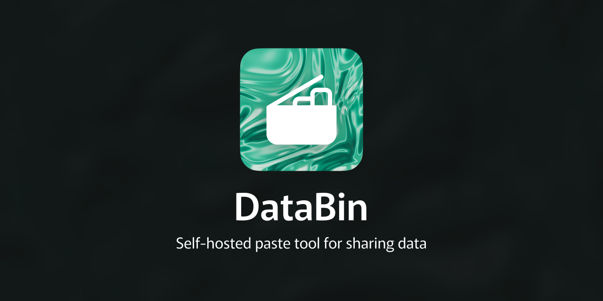

# DataBin



Lightweight Self-hosted pastebin (Hastebin-compatible API) on Go and Redis.

## Features

- Web UI with Tailwind and [highlight.js](https://highlightjs.org/) syntax highlighting;
- **Fork & edit** copies a paste into the editor as a new document
- HTTP API (create returns JSON `id` + one-time `token`)
- Pastes stored in Redis (optional TTL)
- Docker Compose for one-command deployment
- CLI support
- Optional view password and burn-after-read on create
- Paste analytics (views, daily chart, countries with local GeoIP database)
- Rate limiting on create; configurable edit/delete time limits and on/off flags
- Redis memory cap with automatic eviction of oldest pastes (`PASTE_MAX_TOTAL_MEMORY_MB`)
- Gzip storage in Redis; `Cache-Control` on `/raw` and `/download` when pastes are immutable

## Quick start (Docker)

```bash
make env && make deploy
```

Open http://localhost:3000

## Start from local version

**Go on the host:**

```bash
make env
make local    # or: make redis && make dev
```

## API endpoints

| Method | Path | Description |
|--------|------|-------------|
| `POST` | `/documents` | Create paste. Body: raw text. Response: JSON `{"id":"…","token":"…"}` (shown once). Optional burn-after-read: header `X-Databin-Burn: 1` or query `?burn=1`. Optional view password: header `X-Databin-Password`. Rate-limited per IP (see `RATE_LIMIT_POST_PER_MINUTE`). |
| `PUT` | `/documents/{id}` | Update paste (if enabled). Requires `X-Databin-Token` or `?token=`. |
| `DELETE` | `/documents/{id}` | Delete paste (if enabled and within the delete window). Requires token. |
| `GET` | `/raw/{id}` | Raw text. |
| `GET` | `/download/{id}` | Download as `{id}.txt`. |
| `GET` | `/{id}` | HTML view with highlighting. Optional `?lang=go`. With `User-Agent` from **curl**, **wget**, or **HTTPie**, returns ANSI syntax-highlighted text in the terminal. **Analytics** in the UI requires the token. |
| `GET` | `/documents/{id}/stats` | JSON views, daily counts, countries. Requires `X-Databin-Token`. |

### Examples

```bash
# Create (save token from the JSON response)
curl -s -X POST -d 'package main; func main() {}' http://localhost:3000/documents

# Burn-after-read (deleted on first GET /{id}, /raw/{id}, or /download/{id})
curl -s -X POST -H 'X-Databin-Burn: 1' -d 'secret-token' http://localhost:3000/documents

# Password-protected view (bcrypt hash in Redis; password only for read)
curl -s -X POST -H 'X-Databin-Password: s3cret' -d 'hidden' http://localhost:3000/documents
curl -s -H 'X-Databin-Password: s3cret' http://localhost:3000/raw/PASTE_ID

# Raw
curl -s http://localhost:3000/raw/abcdef1234

# CLI view (syntax highlighting in the terminal)
curl -s 'http://localhost:3000/abcdef1234?lang=go'

# Update / delete / stats
curl -s -X PUT -H 'X-Databin-Token: TOKEN' -d 'updated' http://localhost:3000/documents/PASTE_ID
curl -s -X DELETE -H 'X-Databin-Token: TOKEN' http://localhost:3000/documents/PASTE_ID
curl -s -H 'X-Databin-Token: TOKEN' http://localhost:3000/documents/PASTE_ID/stats
```

## Configuration

| Variable | Default | Description |
|----------|---------|-------------|
| `APP_URL` | - | Public site URL for Open Graph (e.g. `https://paste.example.com`) |
| `APP_SECRET` | `REDIS_PASSWORD` or built-in dev default | Signs unlock cookies for password-protected pastes in the browser |
| `REDIS_HOST` | `127.0.0.1` | Redis host |
| `REDIS_PASSWORD` | - | Redis password (`requirepass` in Docker) |
| `PASTE_TTL_HOURS` | `0` | Expiration; `0` = no expiry |
| `PASTE_MAX_BYTES` | `2097152` | Max paste size (2 MiB) |
| `PASTE_MAX_TOTAL_MEMORY_MB` | `0` | If Redis `used_memory` exceeds this, oldest pastes are removed before create; `0` = off. Create fails with **507** if nothing can be evicted |
| `PASTE_KEY_LENGTH` | `10` | Random id length |
| `PASTE_EDIT_ENABLED` | `true` | Allow `PUT /documents/{id}` |
| `PASTE_EDIT_MAX_AGE_SECONDS` | `0` | After creation, edits allowed only within this many seconds; `0` = no limit |
| `PASTE_DELETE_ENABLED` | `true` | Allow `DELETE /documents/{id}` |
| `PASTE_DELETE_MAX_AGE_SECONDS` | `0` | After creation, deletes allowed only within this many seconds; `0` = no limit |
| `RATE_LIMIT_POST_PER_MINUTE` | `5` | Max `POST /documents` per client IP per minute; `0` = disabled |
| `GEOIP_DB_PATH` | - | Optional local MaxMind GeoLite2 Country `.mmdb` for country stats |
